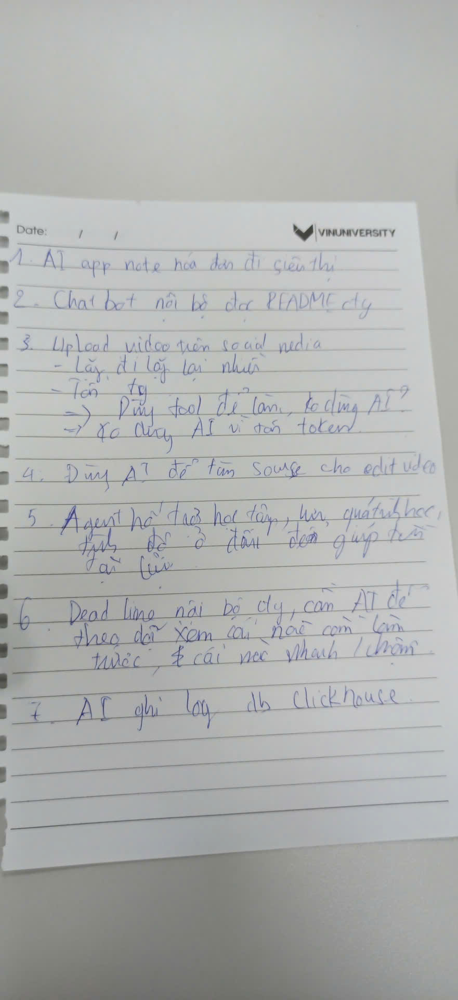

# Báo cáo nhóm — Day 02 Discovery & Problem Framing

> Bản chung của nhóm, viết trên repo do nhóm trưởng fork. Không copy file này sang repo cá nhân.
> Template chi tiết và prompt mẫu: [docs/01-worksheet.md](../../docs/01-worksheet.md). Bài mẫu: [docs/02-deliverable-example.md](../../docs/02-deliverable-example.md).

## 1. Thông tin nhóm

- Tên nhóm: **[Chưa được cung cấp — cần nhóm điền]**
- Thành viên: xem `TEAM.md`
- Candidate problem nhóm chọn (1 câu): Giảm thao tác lặp lại và sai sót khi đăng cùng một video lên nhiều nền tảng mạng xã hội.
- Quyết định cuối: No-Go

---

## 2. Hội tụ nhóm (CP3)

### 2.1. Pitch
**Ảnh ghi chú thảo luận candidate của nhóm (CP3):**



*Ảnh ghi lại các **chủ đề** nhóm đã nêu (đặc biệt các ý liên quan #1, #2, #4, #5, #7, #8 và #12). Ảnh không phải biên bản đầy đủ cả 12 Job Story hay bằng chứng phỏng vấn người dùng.*


**Nguồn:** Các ý #1–2, #4–5, #7–8 được người dùng thuật lại từ nhóm; #10–12 là ba candidate của Nguyễn Văn Minh. Các ý bổ sung #3, #6, #9 **đã được Nguyễn Văn Minh xác nhận đưa vào danh sách**. Bước nghẽn là nhận định ban đầu, chưa có số phút đo. Phần hỏi–đáp #1 do người dùng cung cấp; #2–#12 là phương án do AI đề xuất, không phải biên bản đối thoại đã diễn ra.

| # | Người đưa ra | Candidate (Job Story ngắn) | Actor | Bottleneck | Câu hỏi phản biện nhận được (ai hỏi) |
|---:|---|---|---|---|---|
| 1 | Nguyễn Đức Đạt | Khi đăng cùng một video lên nhiều nền tảng mạng xã hội, tôi muốn hoàn tất việc đăng đúng định dạng và thông tin, để tránh thao tác lặp lại và bỏ sót kênh. | Người sáng tạo nội dung | Chỉnh thông tin và upload riêng lên từng nền tảng | Xem phan hoi-dap #1 ben duoi |
| 2 | Nguyễn Đức Đạt | Khi dựng video cần âm thanh, hình ảnh và clip minh họa, tôi muốn tìm tư liệu phù hợp, có quyền sử dụng, để hoàn thành video mà không tốn nhiều thời gian tìm kiếm. | Người dựng video | Tìm, lọc và kiểm tra quyền dùng sound effect, ảnh, clip ngắn | Xem phan hoi-dap #2 ben duoi |
| 3 | Nguyễn Đức Đạt | Khi dựng video ngắn có lời thoại, tôi muốn tạo và đồng bộ phụ đề với thời điểm nói, để người xem hiểu nội dung khi tắt âm thanh. | Người dựng video ngắn | Nghe lại, chép lời, căn thời điểm phụ đề | Xem phan hoi-dap #3 ben duoi |
| 4 | Võ Công Minh | Khi mua thực phẩm ở siêu thị, tôi muốn biết tổng chi tiêu từ các hóa đơn mua hàng, để quản lý ngân sách thực phẩm chính xác. | Người mua hàng | Đọc, nhập và cộng từng khoản trên hóa đơn siêu thị | Xem phan hoi-dap #4 ben duoi |
| 5 | Võ Công Minh | Khi bắt đầu nhiệm vụ trong công ty có nhiều repository, tôi muốn tìm đúng hướng dẫn trong các README nội bộ, để hiểu dự án mà không cần hỏi đi hỏi lại. | Lập trình viên / nhân viên kỹ thuật | Tìm và đối chiếu thông tin giữa nhiều README | Xem phan hoi-dap #5 ben duoi |
| 6 | Võ Công Minh | Khi thư viện của dự án được cập nhật, tôi muốn xác định thay đổi nào ảnh hưởng tới mã nguồn hiện tại, để hạn chế lỗi sau nâng cấp. | Lập trình viên bảo trì dự án | Đọc changelog và đối chiếu thay đổi với các thành phần đang dùng | Xem phan hoi-dap #6 ben duoi |
| 7 | Tạ Tiến Dũng | Khi tự học nhiều chủ đề có độ khó khác nhau, tôi muốn biết trình độ hiện tại và bài học nên học tiếp, để tiến bộ có định hướng. | Sinh viên / người tự học | Đánh giá mức hiểu và chọn bài phù hợp | Xem phan hoi-dap #7 ben duoi |
| 8 | Tạ Tiến Dũng | Khi có nhiều bài tập và deadline, tôi muốn biết việc nào cần ưu tiên, để tránh trễ hạn và sử dụng thời gian hợp lý. | Sinh viên có nhiều bài tập | Tập hợp deadline, độ khó và ưu tiên từ nhiều nguồn | Xem phan hoi-dap #8 ben duoi |
| 9 | Tạ Tiến Dũng | Khi làm bài tập nhóm, tôi muốn biết ai đang phụ trách việc gì và phần nào còn thiếu, để nhóm phối hợp và nộp đúng hạn. | Thành viên nhóm học tập | Tổng hợp tiến độ từ chat, file và ghi chú rời rạc | Xem phan hoi-dap #9 ben duoi |
| 10 | Nguyễn Văn Minh | Khi kiểm tra KillyTech trên điện thoại, tôi muốn xác định thành phần và breakpoint gây lỗi giao diện, để sửa mà không làm hỏng kích thước màn hình khác. | Lập trình viên frontend | Dò CSS/breakpoint xung đột khi debug responsive | Xem phan hoi-dap #10 ben duoi |
| 11 | Nguyễn Văn Minh | Khi nhận repo lab có nhiều file hướng dẫn, tôi muốn đối chiếu yêu cầu, cách chấm và cách nộp, để không bỏ sót phần bắt buộc. | Học viên làm lab GitHub | Đối chiếu README, RULES, CHECKPOINTS, RUBRIC, SUBMISSION | Xem phan hoi-dap #11 ben duoi |
| 12 | Nguyễn Văn Minh | Khi ClickHouse trên WSL bị lỗi ghi dữ liệu, tôi muốn xác định quyền hoặc cấu hình gây lỗi, để khôi phục thao tác an toàn. | Lập trình viên sử dụng ClickHouse/WSL | Xác định quyền của service và thư mục dữ liệu | Xem phan hoi-dap #12 ben duoi |


**Phản biện theo từng candidate (người hỏi: Nguyễn Văn Minh).** Cặp #1 là nội dung người dùng xác nhận. Cặp #2–#12 là các câu hỏi và câu trả lời **do AI gợi ý để chuẩn bị và hoàn thiện phần phân tích**, không khẳng định đã diễn ra trong buổi thảo luận. Nếu cần minh chứng CP3, chỉ ghi nhận những trao đổi thực sự đã diễn ra.

**1. Người hỏi: Nguyễn Văn Minh** (đã được cung cấp)

- **Câu hỏi:** Tại sao không dùng AI để làm cho nhanh, tại sao lại dùng tools và code?
- **Trả lời đề xuất:** Dùng tools vì độ chính xác cao và hoàn toàn có thể tự làm được, không cần AI.

**2. Người hỏi: Nguyễn Văn Minh**

- **Câu hỏi:** Vì sao không tìm tư liệu bằng thư viện và từ khóa thay vì AI?
- **Trả lời đề xuất:** Có thể dùng thư viện và bộ lọc trước, vì dễ kiểm tra nguồn và giấy phép. Chỉ cân nhắc AI khi việc tìm kiếm thủ công thật sự tốn thời gian.

**3. Người hỏi: Nguyễn Văn Minh**

- **Câu hỏi:** Có cần tự xây AI tạo phụ đề khi phần mềm dựng video đã có chức năng này?
- **Trả lời đề xuất:** Nên thử tính năng sẵn có trước. Người dựng vẫn cần rà soát sai từ, tên riêng và thời điểm xuất hiện phụ đề.

**4. Người hỏi: Nguyễn Văn Minh**

- **Câu hỏi:** Nếu mục tiêu chỉ là cộng tiền hóa đơn, vì sao không dùng bảng tính?
- **Trả lời đề xuất:** Nếu chỉ cộng tổng, bảng tính hoặc máy tính đã đủ. Nhận diện hóa đơn tự động chỉ hữu ích khi có nhiều hóa đơn và người dùng cần nhập thường xuyên.

**5. Người hỏi: Nguyễn Văn Minh**

- **Câu hỏi:** Chatbot đọc README nội bộ có nguy cơ lộ dữ liệu công ty không?
- **Trả lời đề xuất:** Có, nếu gửi tài liệu sang bên thứ ba khi chưa được phép. Cần kiểm soát quyền truy cập, đồng thời thử cải thiện tài liệu và tìm kiếm nội bộ trước.

**6. Người hỏi: Nguyễn Văn Minh**

- **Câu hỏi:** Có thể dùng changelog và kiểm thử thay cho AI đánh giá tác động nâng cấp không?
- **Trả lời đề xuất:** Có. Đọc changelog, kiểm tra phụ thuộc và chạy test là căn cứ chính; AI chỉ hỗ trợ tóm tắt, không thể thay kết quả kiểm thử.

**7. Người hỏi: Nguyễn Văn Minh**

- **Câu hỏi:** Làm sao biết bài học gợi ý phù hợp nếu chưa có dữ liệu đánh giá trình độ?
- **Trả lời đề xuất:** Cần bài kiểm tra đầu vào và kết quả học tập. Nếu thiếu dữ liệu, nên bắt đầu bằng lộ trình học rõ ràng thay vì để agent tự suy đoán.

**8. Người hỏi: Nguyễn Văn Minh**

- **Câu hỏi:** Dùng lịch và nhắc việc đã đủ, tại sao phải dùng agent để quản lý deadline?
- **Trả lời đề xuất:** Lịch và quy tắc ưu tiên thường đáp ứng được phần lớn nhu cầu. Chỉ cân nhắc agent khi nhiều ràng buộc thay đổi phức tạp và có bằng chứng cách cũ không đủ.

**9. Người hỏi: Nguyễn Văn Minh**

- **Câu hỏi:** Nếu nhóm có bảng phân công chung, còn cần agent theo dõi tiến độ không?
- **Trả lời đề xuất:** Chưa chắc. Một bảng phân công có trách nhiệm rõ ràng và cập nhật đều đặn là giải pháp đơn giản hơn; cần xác minh vấn đề trước.

**10. Người hỏi: Nguyễn Văn Minh**

- **Câu hỏi:** Có chắc tìm lỗi CSS là bước lâu nhất, hay lỗi do thiếu kiểm thử responsive?
- **Trả lời đề xuất:** Chưa thể kết luận khi chưa bấm giờ. Nên đo từng bước và thử checklist breakpoint, DevTools cùng kiểm thử hồi quy trước.

**11. Người hỏi: Nguyễn Văn Minh**

- **Câu hỏi:** Nếu lập checklist theo rubric một lần là đủ thì có cần AI không?
- **Trả lời đề xuất:** Chưa chắc. Checklist thủ công có thể đủ nếu đề ít thay đổi; cần đo thời gian và số mục bị bỏ sót.

**12. Người hỏi: Nguyễn Văn Minh**

- **Câu hỏi:** Có nên để AI tự sửa permission của ClickHouse để nhanh hơn không?
- **Trả lời đề xuất:** Không nên khi chưa xác định nguyên nhân. Cần kiểm tra log, user service và quyền thư mục; con người phê duyệt thay đổi tối thiểu.

**Đối chiếu với báo cáo cá nhân sau khi hợp nhất các branch:** Bảng pitch này là danh sách candidate nhóm do Nguyễn Văn Minh cung cấp và xác nhận. Tuy nhiên, danh sách Top 3 Problem Card trong một số báo cáo cá nhân hiện khác với bảng pitch: Nguyễn Đức Đạt có card nghiên cứu đối thủ/xu hướng thay cho phụ đề; Võ Công Minh có card kiểm tra trợ lý sửa code và đọc repo thay cho cập nhật thư viện; Tạ Tiến Dũng có card ghi biên bản họp, tra cứu tài liệu và chọn tài liệu theo trình độ. **Cần từng thành viên xác nhận** đâu là ba candidate thực sự đã pitch; không nên mặc nhiên coi các gợi ý trong mục 2.1 là phát biểu đã xảy ra. Bản báo cáo cá nhân đã được giữ nguyên phần nội dung khi hợp nhất.

### 2.2. Cluster

Các candidate được gom theo **bối cảnh và pain chung**, không gom theo việc có sử dụng AI hay không. Số thứ tự đối chiếu với bảng pitch ở mục 2.1. Đây là cách phân nhóm được xây dựng từ danh sách đã xác nhận; nhóm có thể điều chỉnh nếu ghi chép thảo luận chi tiết cho kết quả khác.

| Cluster | Các candidate | Pattern chung |
|---|---|---|
| **A — Sản xuất và xuất bản nội dung số** | **#1** Đăng video đa nền tảng; **#2** tìm tư liệu dựng video; **#3** tạo và đồng bộ phụ đề | Người làm nội dung gặp các thao tác thủ công khi chuẩn bị, hoàn thiện và phân phối video. Điểm chung là thời gian thao tác và yêu cầu kiểm tra đầu ra. |
| **B — Quản lý thông tin và công việc cá nhân/nhóm** | **#4** tổng hợp chi tiêu siêu thị; **#7** xác định lộ trình học; **#8** ưu tiên deadline; **#9** theo dõi tiến độ bài tập nhóm | Người dùng phải thu thập nhiều dữ liệu nhỏ, tổng hợp trạng thái và quyết định bước tiếp theo; độ phức tạp khác nhau nên chưa thể kết luận cùng một giải pháp. |
| **C — Tìm hiểu tài liệu và thay đổi kỹ thuật** | **#5** tra cứu README nội bộ; **#6** hiểu tác động cập nhật thư viện; **#11** đối chiếu hướng dẫn lab | Thông tin phân tán qua nhiều tài liệu; người đọc cần tìm đúng phần liên quan, đối chiếu các quy định hoặc thay đổi và tránh bỏ sót. |
| **D — Chẩn đoán lỗi trong phát triển phần mềm** | **#10** tìm nguyên nhân lỗi responsive; **#12** phân tích lỗi quyền ghi ClickHouse/WSL | Người phát triển cần tái hiện lỗi, khoanh vùng nguyên nhân, kiểm tra log/cấu hình và xác minh kết quả sau sửa. |

**Hướng hội tụ:** Theo kết quả nhóm đã ghi ở mục 1, candidate được chọn để đào sâu là **#1 — đăng video trên nhiều nền tảng mạng xã hội** (Cluster A). Lý do phân tích: actor và hành động lặp lại khá cụ thể; có thể mô tả từng bước đăng tải, đo thời gian và so sánh phương án sửa quy trình, Rule/tool với AI. Đây là cơ sở lý giải được đề xuất từ nội dung hiện có, **không phải bảng điểm hay lý do được xác nhận từ biên bản họp**; phần chấm điểm và loại candidate chính thức nằm ở mục 2.4.

### 2.3. Opportunity Solution Tree rút gọn

**Outcome duy nhất (cho candidate #1):** Giảm thời gian và sai sót khi một người đăng cùng một video lên nhiều nền tảng, đồng thời bảo đảm nội dung được đăng đủ kênh và đúng yêu cầu. **Cách đo dự kiến:** số phút từ lúc video sẵn sàng đến khi xác nhận đăng xong; số thao tác lặp; số lỗi/thiếu nền tảng trên mỗi lượt đăng. **Baseline và target:** chưa đo, cần bổ sung từ CP4–CP5.

```text
OUTCOME: Dang cung mot video len nhieu nen tang nhanh hon, it loi hon
|
+-- Opportunity A: Phai nhap lai tieu de, mo ta va thong tin dang tai
|                    nhieu lan cho cung mot video
|
+-- Opportunity B: Yeu cau ve dinh dang, ti le va truong thong tin
|                    khac nhau giua cac nen tang de gay sai sot
|
+-- Opportunity C: Kho kiem tra da dang thanh cong va dung kenh
                     khi phai theo doi tung nen tang rieng
```

Ba nhánh trên đều là **pain/nhu cầu**, không phải tên công cụ hay tính năng. Đây là những **giả thuyết xuất phát từ candidate #1**; cần kiểm chứng bằng quy trình đăng thực tế, log hoặc phỏng vấn người làm nội dung trước khi coi là pain đã được chứng minh.

**Những ý cần gạch khỏi tầng opportunity vì thực chất là solution:**

- “Dùng AI để tự upload video lên mọi nền tảng” — là một phương án giải quyết, không phải vấn đề của người đăng.
- “Viết tool hoặc code đăng video tự động” — là một phương án Rule/automation, không phải opportunity.
- “Xây agent tự quyết định thời điểm và kênh đăng” — là kiến trúc giải pháp, chưa chứng minh cần thiết.

**Liên hệ với quyết định No-Go hiện được ghi trong báo cáo:** Nhóm có thể quyết định **không dùng AI** cho khâu đăng tải nếu các thao tác cố định đã xử lý được bằng tool/code, có thể kiểm thử rõ và ít rủi ro hơn. Điều này **không phủ nhận pain** của người dùng; nó chỉ tách bài toán thực tế khỏi cách giải bằng AI. Quyết định cần được hỗ trợ thêm bằng chứng ở CP4 và phân tích rủi ro ở CP6.

### 2.4. Chấm điểm shortlist (1–5)

**Cách chấm:** Mỗi tiêu chí từ 1 (chưa rõ/yếu) đến 5 (rất rõ/tốt), tổng tối đa 35 điểm. Bảng dưới đây là **đánh giá đề xuất dựa trên 12 candidate ở mục 2.1**, không phải số điểm nhóm đã bỏ phiếu hay ghi lại trong buổi họp. Đặc biệt, ảnh ghi chú xác nhận các chủ đề được thảo luận nhưng **không chứng minh mức độ đau của người dùng**, nên tiêu chí "Pain có bằng chứng" hiện chỉ chấm 1/5 cho cả ba ứng viên. Nhóm cần đối chiếu và điều chỉnh điểm khi có dữ liệu kiểm chứng ở CP4.

| Candidate | Actor rõ | Quy trình rõ | Pain có bằng chứng | Impact đo được | Vừa sức lab | So sánh được No AI/Rule/Workflow/Agent | Nhóm hiểu domain | Tổng |
|---|---:|---:|---:|---:|---:|---:|---:|---:|
| **#1 — Đăng video lên nhiều mạng xã hội** | 5 | 5 | 1 | 5 | 5 | 5 | 4 | **30/35** |
| **#2 — Tìm tư liệu cho dựng video** | 5 | 4 | 1 | 4 | 4 | 4 | 3 | **25/35** |
| **#5 — Tra cứu nhiều README nội bộ** | 4 | 4 | 1 | 4 | 3 | 4 | 3 | **23/35** |

**Lý giải điểm số:**

- **#1:** Actor và các bước đăng tải rõ; có thể đo thời gian cho mỗi lượt đăng, số thao tác lặp và tỷ lệ đăng đúng kênh. Phạm vi dễ thu hẹp thành 2–3 nền tảng để khảo sát; đặc biệt phù hợp so sánh thao tác thủ công, công cụ/scripting và AI. Tuy nhiên chưa có log hay phỏng vấn chứng minh thời gian mất thực tế.
- **#2:** Người dựng video và pain tìm tư liệu khá cụ thể; có thể đo thời gian tìm được tài nguyên phù hợp. Việc đánh giá mức độ phù hợp, bản quyền, chất lượng và hiệu quả tìm kiếm phức tạp hơn khâu đăng video; chưa có bằng chứng số phút phải tìm.
- **#5:** Nhu cầu tìm thông tin trong README hợp lý với nhân viên kỹ thuật, nhưng phụ thuộc cấu trúc repository, quyền truy cập và bảo mật công ty. Trong phạm vi buổi lab khó có dữ liệu nội bộ hoặc đánh giá đầu ra đầy đủ. Chưa có phỏng vấn xác nhận pain từ nhân viên.

**Candidate được chọn:** **#1 — Rút ngắn và giảm sai sót khi đăng cùng một video lên nhiều nền tảng mạng xã hội.**

**Vì sao chọn:** Đây là candidate mà nhóm đã ghi nhận ở mục 1. Bài toán có hành động lặp lại, actor rõ và quy trình dễ mô tả; có thể phân biệt **vấn đề cần giải quyết** với **giải pháp AI**. Có khả năng kiểm thử một quy trình đăng thủ công rồi đối chiếu công cụ lập lịch hoặc rule/script, trước khi cân nhắc AI. Lựa chọn candidate để nghiên cứu **không đồng nghĩa** với việc chọn xây hệ thống AI. Quyết định **No-Go đối với AI** hiện được ghi ở mục 1 phù hợp với giả thuyết rằng thao tác có thể xử lý bằng tool/code; điều này vẫn cần được chứng minh ở CP4–CP6.

**Vì sao loại các candidate còn lại khỏi shortlist cuối:**

- **#2 — Tìm tư liệu dựng video:** Khó đặt tiêu chí "tư liệu phù hợp" thống nhất giữa các video và còn phải xác minh quyền sử dụng. Chưa có bằng chứng đủ mạnh về tần suất, thời gian và mức độ ưu tiên.
- **#5 — Tra cứu README nội bộ:** Cần quyền truy cập tài liệu công ty và xử lý bảo mật; đánh giá hiệu quả khó tiến hành đầy đủ nếu không có môi trường và người dùng thực tế.
- **Các candidate khác (#3, #4, #6–#12):** Không phủ nhận giá trị của chúng, nhưng trong một buổi lab việc thu thập bằng chứng và so sánh bốn mức can thiệp cho tất cả các chủ đề sẽ quá rộng. Những vấn đề như cộng hóa đơn hoặc quản lý deadline có thể bắt đầu bằng công thức, checklist và lịch; các vấn đề debug phần mềm cần log thực tế để xác định bottleneck.

**Xử lý bất đồng (nếu có):** Chưa có biên bản cụ thể về bất đồng hoặc kết quả bỏ phiếu. Nếu nhóm từng có ý kiến khác nhau, cần bổ sung đúng ý kiến, người tham gia và cách đi đến thống nhất; không giả định nhóm đã biểu quyết theo bảng điểm đề xuất này.

---

## 3. Kiểm chứng + research giải pháp đã có (CP4)

### 3.1. Assumption Map

| # | Giả định | Loại (Value / Usability / Feasibility / Viability) | Quan trọng (1–5) | Đã có bằng chứng (1–5) | Kiểm chứng trước? |
|---:|---|---|---:|---:|---|
| 1 | | | | |  |
| 2 | | | | |  |
| 3 | | | | |  |
| 4 | | | | |  |
| 5 | | | | |  |
| 6 | | | | |  |

*Điền 4–6 giả định; xóa dòng thừa.*

Giả định nhóm kiểm chứng trong buổi này:

### 3.2. Kiểm chứng

Cách đã dùng: Phỏng vấn / Survey / Log, ticket, review

Interview snapshot (mỗi buổi phỏng vấn một bảng, hoặc đặt file trong `report/assets/cp4-interview-snapshot-N.md`):

| Trường | Nội dung |
|---|---|
| Người được hỏi (vai trò, không ghi tên thật) | |
| Câu nói đáng nhớ nhất (nguyên văn) | |
| Lần gần nhất gặp vấn đề này: chuyện gì đã xảy ra? | |
| Hiện đang xử lý bằng cách nào (workaround)? | |
| Mất bao lâu, bao lần? | |
| Insight / opportunity rút ra | |

Tổng hợp:

| Nguồn | Số người / số mẫu | Tín hiệu xác nhận | Tín hiệu phản bác |
|---|---:|---|---|
| | | | |

**Nhóm đã sửa problem thế nào sau kiểm chứng:**

### 3.3. Research giải pháp đã có

| Công cụ / case / pattern | Link | Giải bước nào trong quy trình? | Điểm mạnh | Khoảng trống / rủi ro | Bài học cho nhóm |
|---|---|---|---|---|---|
| | | | | | |
| | | | | | |
| | | | | | |

---

## 4. Quy trình trước/sau (CP5)

**Bài toán phân tích:** Phân phối video Education Animation lên YouTube Shorts, TikTok và Instagram Reels, giảm thao tác nhập và cấu hình lặp lại.

**Trạng thái dữ liệu:** Các thời gian hiện tại do học viên cung cấp đều là ước lượng, chưa bấm giờ. Quy trình tương lai là phương án đề xuất, chưa thử nghiệm. Chưa xác định tần suất xuất bản. Nội dung phần này chưa thay thế kết quả chọn problem ở CP3 hoặc kiểm chứng ở CP4.

**Phạm vi so sánh:** Từ khi đã có file video hoàn chỉnh, được kiểm tra chất lượng, đến khi kiểm tra xong nội dung và trạng thái đăng/hẹn giờ trên cả ba nền tảng. Loại 10 phút xuất và kiểm tra video khỏi cả hai quy trình. Vì vậy, baseline trong phạm vi này là **110 phút/lần**, thay vì 120 phút của quy trình ban đầu có cả bước xuất video.

**Mục tiêu ưu tiên:** Chuẩn bị dữ liệu tại một nơi và giảm thao tác lặp; không bắt buộc ba nền tảng công khai cùng một thời điểm. Creator duyệt riêng nội dung và lịch đăng của từng nền tảng.

### 4.1. Quy trình hiện tại

**Actor chính:** Creator kênh Education Animation tự vận hành phân phối đa kênh (solopreneur).

```text
ĐẦU VÀO: Video đã hoàn chỉnh và được kiểm tra chất lượng

[1. Soạn tiêu đề, caption gốc, hashtag và chọn cover: 30 phút]
→ [2. Đăng và cấu hình YouTube Shorts: 25 phút]
→ [3. Điều chỉnh nội dung và đăng TikTok: 30 phút] ← VÙNG NGHI NGỜ NGHẼN
→ [4. Điều chỉnh nội dung và đăng Instagram Reels: 20 phút] ← CẦN ĐO THÊM
→ [5. Kiểm tra nội dung, hiển thị và trạng thái ba nền tảng: 5 phút]

TỔNG: 110 phút/lần xuất bản, theo ước lượng.
```

| Bước | Actor | Input | Công việc và Output | Thời gian / tần suất | Ghi chú |
|---:|---|---|---|---|---|
| 1 | Creator | Video hoàn chỉnh, nội dung kiến thức | Viết tiêu đề, caption, hashtag và chọn cover → bộ thông tin đăng ban đầu | Khoảng 30 phút/lần xuất bản | Chưa tách thời gian viết, chọn hashtag và chọn cover. |
| 2 | Creator, nền tảng YouTube | Video và bộ thông tin ban đầu | Tải video, điền thông tin, cấu hình danh sách phát/lịch đăng theo nhu cầu → bài YouTube Shorts đã cấu hình | Khoảng 25 phút/lần xuất bản | Gồm thao tác và thời gian nền tảng xử lý; chưa tách riêng. |
| 3 | Creator, nền tảng TikTok | Video và bộ thông tin ban đầu | Điều chỉnh caption/hashtag, thiết lập nhạc nếu cần, tải và cấu hình đăng → bài TikTok đã cấu hình | Khoảng 30 phút/lần xuất bản | Vùng nghi ngờ nghẽn; chưa rõ thời gian chỉnh nội dung so với tải và cấu hình. |
| 4 | Creator, nền tảng Instagram | Video và bộ thông tin ban đầu | Điều chỉnh caption, chọn cover, tải và cấu hình đăng → bài Instagram Reels đã cấu hình | Khoảng 20 phút/lần xuất bản | Còn lặp lại việc chuyển dữ liệu và cấu hình trên giao diện khác. |
| 5 | Creator | Bài đăng và trạng thái từng nền tảng | Kiểm tra nội dung, hiển thị và trạng thái đăng/hẹn giờ → kết quả kiểm tra và lỗi cần xử lý | Khoảng 5 phút/lần xuất bản | Nếu hẹn giờ, kiểm tra cấu hình trước và kiểm tra công khai khi đến giờ; phần chờ đến giờ không tính vào thời gian thao tác. |

**Bottleneck chính — giả thuyết cần kiểm chứng:** Vùng bước 3–4 chiếm khoảng 50 phút, có nhiều thao tác điều chỉnh và đăng lặp lại. Chưa đủ cơ sở khẳng định sửa caption/hashtag là bước nghẽn chính vì chưa tách được: (a) chỉnh nội dung, (b) thao tác cấu hình, (c) chờ tải/xử lý video. Cần đo riêng từng phần; 50 phút không được coi là toàn bộ thời gian có thể loại bỏ bằng tự động hóa.

**Handoff:** Creator chuyển video và nội dung cho từng nền tảng, nhận trạng thái xử lý rồi tự kiểm tra. Không có người khác nhận bàn giao trong quy trình mô tả.

### 4.2. Quy trình tương lai

**Phương án:** Template dùng chung + Rule hỗ trợ phân phối và theo dõi trạng thái. Creator tự viết và điều chỉnh nội dung; quy trình này không có bước AI tạo hoặc tối ưu caption/hashtag. Khả năng kết nối, đăng/hẹn giờ và các trường được hỗ trợ trên từng nền tảng phải được kiểm tra trước khi triển khai.

```text
[1. CON NGƯỜI: Chuẩn bị video và bộ nội dung cho từng nền tảng tại một nơi]
→ [2. CON NGƯỜI: Kiểm tra, sửa và duyệt riêng từng nền tảng]
→ [3. RULE: Kiểm tra điều kiện, gửi bản đã duyệt và ghi trạng thái từng kênh]
→ [4. CON NGƯỜI: Kiểm tra kết quả và xử lý ngoại lệ]

ĐIỂM KIỂM SOÁT: Chưa duyệt thì không gửi; sửa bản đã duyệt thì phải duyệt lại.
QUAY VỀ: Kết nối lỗi hoặc trường không được hỗ trợ → creator đăng/cấu hình thủ công.
```

| Bước | Phân công | Input | Công việc và Output | Thời gian / tần suất |
|---:|---|---|---|---|
| 1 | Con người | Video hoàn chỉnh, kiến thức trong video, template | Creator chuẩn bị tiêu đề, caption, hashtag, cover và lịch đăng riêng từng nền tảng trong một nơi → bộ dữ liệu đăng tập trung | Chưa ước lượng lại; thực hiện mỗi lần xuất bản. Không dùng thời gian của phương án AI cũ. |
| 2 | Con người — bước kiểm tra bắt buộc | Bộ dữ liệu từng nền tảng | Kiểm tra nội dung kiến thức, đúng file video, thông tin, cover và lịch đăng; sửa rồi duyệt riêng → các phiên bản được phép gửi | Chưa đo; gồm cả thời gian sửa trước khi duyệt. |
| 3 | Rule | Phiên bản đã duyệt, cấu hình nền tảng và kết nối hợp lệ | Kiểm tra trường bắt buộc theo cấu hình đã xác minh; gửi đăng/hẹn giờ; lưu mã bài và trạng thái từng nền tảng → kết quả thành công, thất bại hoặc đang xử lý | Chưa đo; phải tách thời gian điều phối khỏi thời gian chờ tải/xử lý. |
| 4 | Con người — bước kiểm tra sau gửi | Bài đăng, lịch đăng, trạng thái và thông báo lỗi | Kiểm tra nội dung/hiển thị, đối chiếu bản đã duyệt; xử lý kênh lỗi → xác nhận hoàn tất hoặc danh sách việc cần làm thủ công | Chưa đo; thời gian xử lý ngoại lệ ghi riêng. |

**Boundary:**

- Rule chỉ gửi phiên bản đã được creator duyệt cho đúng nền tảng và đúng lịch. Mỗi nền tảng có trạng thái duyệt riêng; thay đổi nội dung hoặc lịch sau duyệt phải duyệt lại.
- Rule không tự viết lại nội dung, thay hashtag, chọn nhạc hoặc thay đổi kiến thức trong video/caption.
- Chỉ tự động hóa những thao tác được kết nối hỗ trợ và đã kiểm tra; không giả định mọi thiết lập trên giao diện đều làm được qua công cụ/API.
- Nếu thiếu thông tin bắt buộc, kết nối không hợp lệ hoặc trạng thái bài trước chưa rõ, dừng riêng kênh đó để creator xử lý; không gửi lại một cách mù quáng.
- Creator giữ quyền quyết định xuất bản và chịu trách nhiệm kiểm tra kết quả.

**Phương án quay về khi nội dung, kết nối hoặc Rule có lỗi:**

- Nội dung chưa đạt: creator sửa thủ công theo template, duyệt lại rồi mới gửi.
- Kết nối không khả dụng hoặc trường cấu hình không được hỗ trợ: xuất bộ nội dung đã duyệt để creator đăng hoặc hoàn thiện cấu hình thủ công trên nền tảng đó.
- Một kênh thất bại: kiểm tra bài có được tạo chưa, giữ nguyên các kênh đã thành công và chỉ thử lại phần lỗi khi chắc chắn không tạo bài trùng.
- Phát hiện nội dung hoặc lịch đăng sai sau gửi: creator kiểm tra và sửa/hủy theo khả năng của nền tảng, ghi nhận lỗi để điều chỉnh quy trình.

### 4.3. Before / after

Đếm các bước chính từ chuẩn bị thông tin đăng đến kiểm tra kết quả, trong cùng phạm vi đã nêu. Số bước ít hơn không tự chứng minh tiết kiệm thời gian; quy trình sau vẫn phải xử lý và theo dõi riêng từng nền tảng.

| Chỉ số | Trước — ước lượng | Sau — kỳ vọng, chưa đo | Ghi chú |
|---|---|---|---|
| Số bước chính | 5 | 4 | Gom thao tác phân phối ba kênh vào bước Rule, bổ sung điểm duyệt rõ ràng. |
| Tổng thời gian | Khoảng 110 phút/lần | Chưa ước lượng lại sau khi bỏ bước AI | Phải tính cả creator tự soạn nội dung, duyệt, hệ thống gửi/xử lý và kiểm tra; chưa có cơ sở chốt dưới 25 phút. |
| Thời gian con người trực tiếp thao tác | Chưa tách khỏi thời gian chờ trong 110 phút | Chưa đo | Đo riêng để tránh nhầm giảm công thao tác với giảm thời gian tải video. |
| Số bước cần thao tác thủ công | 5/5 | 3/4 khi kết nối đáp ứng yêu cầu | Creator vẫn chuẩn bị nội dung, duyệt và kiểm tra; khi kết nối lỗi phát sinh thêm thao tác thủ công. |
| Bottleneck chính | Nghi ngờ bước điều chỉnh/đăng TikTok và Instagram; chưa xác định phần chiếm nhiều thời gian nhất | Có thể còn ở soạn/duyệt nội dung hoặc chờ nền tảng xử lý | Bỏ AI nên phần sáng tạo và thích ứng nội dung vẫn do creator làm. |
| Rủi ro mới phát sinh | Creator thao tác trực tiếp từng kênh; vẫn có thể nhập nhầm | Gửi sai phiên bản, sai lịch, đăng trùng khi thử lại, kết nối hết hiệu lực hoặc chỉ thành công một phần | Kiểm soát bằng duyệt riêng từng kênh, lưu phiên bản/trạng thái và kiểm tra trước khi thử lại. |
| Phương án quay về | Creator đăng thủ công | Creator dùng bộ nội dung đã duyệt để đăng/cấu hình thủ công riêng kênh lỗi | Không yêu cầu làm lại các kênh đã thành công. |

**Cách đo tiếp theo:** Với mỗi lần xuất bản, ghi giờ bắt đầu/kết thúc cùng phạm vi; ghi riêng thời gian chuẩn bị nội dung, duyệt, cấu hình, chờ tải/xử lý, kiểm tra và sửa lỗi. Ghi số kênh thành công, số lần đăng trùng/sai lịch và số lần phải quay về thủ công. Đối chiếu các video có mức độ chỉnh sửa tương tự trước khi kết luận tiết kiệm thời gian. Nếu có hẹn giờ, ghi thời gian chờ đến lịch công khai riêng, không dùng để so sánh công thao tác.

---

## 5. Problem Statement v0 (CP5)

**Nguồn hợp nhất:** Đạt đã viết Problem Statement v0 theo kịch bản Solo Creator / Education Animation; Công Minh bổ sung giới hạn phạm vi, chỉ ra thời gian chưa được đo và thiết kế quy trình Rule. Bản v0 dưới đây dùng cùng phạm vi với mục 4 (từ lúc video đã hoàn thiện tới khi kiểm tra đăng trên ba nền tảng), để có thể đối chiếu hợp lệ với v1 ở mục 7. Bản đề xuất có AI của Đạt được lưu riêng trong `report/assets/cp5-alternative-ai-proposal.md` để giữ lại đóng góp và phản biện, **không coi đó là giải pháp đã chốt**.

| Trường | Nội dung |
|---|---|
| **Actor** | Người sáng tạo video ngắn tự quản lý nội dung và đăng bài trên nhiều nền tảng, ví dụ kênh Education Animation đăng YouTube Shorts, TikTok và Instagram Reels. |
| **Quy trình** | Khi video đã hoàn chỉnh: soạn bộ thông tin đăng → truy cập và cấu hình lần lượt YouTube, TikTok, Instagram → điều chỉnh caption, hashtag hoặc cover theo kênh → kiểm tra trạng thái đăng và hiển thị. |
| **Bottleneck** | Thao tác cấu hình và điều chỉnh nội dung lặp lại ở các giao diện khác nhau; vùng TikTok/Instagram đang bị nghi ngờ là nơi tốn nhiều thời gian, nhưng **chưa tách được thời gian chỉnh nội dung, thao tác giao diện và chờ upload**. |
| **Impact** | Tốn công thao tác, có khả năng đăng thiếu kênh, sai caption, sai lịch hoặc phải kiểm tra thủ công nhiều nơi. Mức độ và tần suất chưa được kiểm chứng qua phỏng vấn hoặc log đo. |
| **Success Metric** (baseline → target, cách đo) | **Baseline tạm tính:** khoảng 110 phút/lần đăng ba nền tảng, chỉ là ước lượng từ quy trình ở mục 4 (không tính 10 phút xuất video). **Target cần xác lập sau đo thực tế**, ưu tiên giảm thời gian thao tác thủ công mà không tăng sai nội dung hoặc đăng nhầm/trùng. **Cách đo:** bấm giờ từng bước trên nhiều lượt đăng, tách thời gian chờ tải/xử lý và kiểm tra lỗi trên từng kênh. |
| **Boundary** (AI không được làm gì; khi nào cần con người kiểm tra — HITL) | Đây là mô tả vấn đề trước khi lựa chọn giải pháp. Với mọi phương án có tự động hóa: người dùng phải duyệt file, caption, nền tảng, tài khoản và lịch trước khi gửi; không được tự xuất bản bản chưa duyệt, tự sửa nội dung hoặc bỏ qua giới hạn API và quyền riêng tư; cần người kiểm tra kết quả và xử lý ngoại lệ. |

**Các phản biện được nhóm đưa vào phạm vi phân tích (tổng hợp từ bản của Đạt và Công Minh):**

- **Không đồng nhất thời gian render với thời gian đăng:** Quy trình trong tài liệu của Đạt tính 120 phút gồm 10 phút xuất/kiểm tra video; phần của Công Minh giới hạn sau khi video đã hoàn thiện, còn 110 phút. Hai số này **khác phạm vi, không phải hai baseline đo được**.
- **Không suy ra 50 phút là thời gian AI chắc chắn tiết kiệm được:** Cần tách phần viết lại caption, thao tác cấu hình và thời gian chờ nền tảng.
- **Không chọn AI trước khi thử Rule:** Kiểm tra công cụ có sẵn và khả năng API chính thức; không giả định có thể đăng mọi định dạng hay mọi loại tài khoản.
- **Con người kiểm soát:** Người đăng chịu trách nhiệm xem lại nội dung, phê duyệt riêng từng kênh và xác nhận kết quả.

---

## 6. Mức can thiệp AI (CP6)

### 6.1. Ma trận độ mơ hồ × độ phức tạp

**Bài của nhóm nằm ở ô:** Độ mơ hồ thấp × Độ phức tạp trung bình.

**Vì sao:**

- **Độ mơ hồ thấp:** Người dùng đã xác định rõ nội dung cần đăng, các nền tảng đích và thông tin bài đăng. Hệ thống chỉ cần thực hiện những thao tác theo yêu cầu, không phải tự suy luận hay đưa ra quyết định thay người dùng.
- **Độ phức tạp trung bình:** Quy trình đăng tải có thể xác định trước, nhưng mỗi nền tảng mạng xã hội có API, cơ chế xác thực, định dạng nội dung và giới hạn riêng.
- **Tính lặp lại cao:** Các bước tải ảnh/video, nhập caption và đăng bài phải thực hiện nhiều lần trên những nền tảng khác nhau.

**Kết luận:** Bài toán phù hợp với công cụ tự động hóa theo quy tắc (Rule-based Automation), chưa cần tích hợp AI.

### 6.2. So sánh 4 mức

| Mức | Phương án cho bài của nhóm | Đủ khi nào | Rủi ro | Chọn? |
|---|---|---|---|---|
| **No AI** (sửa quy trình) | Sử dụng checklist, lịch đăng bài và bảng quản lý nội dung chung để hạn chế sai sót. | Khi số lượng nền tảng và tần suất đăng bài ít, người dùng có thể thao tác thủ công. | Vẫn phải đăng riêng trên từng nền tảng, chưa giảm đáng kể các thao tác lặp lại. | Không |
| **Rule** | Xây dựng công cụ cho phép tải nội dung một lần, chọn nền tảng, thiết lập thông tin và tự động gửi yêu cầu đăng bài theo quy trình cố định. | Khi người dùng chủ động quyết định nội dung và nền tảng, các thao tác có thể thực hiện qua API hợp lệ. | Giới hạn API, lỗi xác thực, khác biệt định dạng, đăng trùng hoặc đăng thất bại. | **Có** |
| **Workflow** | Kết hợp quy trình đăng bài cố định với AI để gợi ý caption, hashtag hoặc điều chỉnh nội dung theo từng nền tảng. | Khi người dùng có thêm nhu cầu xử lý hoặc tối ưu nội dung bằng AI. | Tăng chi phí, độ phức tạp và nguy cơ AI tạo nội dung không chính xác. | Không |
| **Agent** | AI tự lựa chọn nền tảng, thời điểm đăng, nội dung và công cụ cần sử dụng. | Khi bài toán thực sự yêu cầu lập kế hoạch và ra quyết định linh hoạt qua nhiều bước. | Khó kiểm soát hành động, có nguy cơ đăng sai nội dung, tăng chi phí và rủi ro bảo mật. | Không |

**Mức chọn:** **Rule — Rule-based Automation (không sử dụng AI).**

**Vì sao không chọn mức đơn giản hơn:**

Mức No AI chỉ giúp cải thiện cách tổ chức công việc bằng checklist hoặc lịch đăng bài, nhưng người dùng vẫn phải truy cập từng nền tảng và thực hiện các thao tác tương tự nhau.

Trong khi đó, Rule có thể tự động hóa những bước lặp lại theo quy trình cố định, giúp giảm thời gian thao tác mà không cần AI suy luận.

Vì vậy, Rule là mức can thiệp đơn giản nhất có khả năng giải quyết trực tiếp bottleneck của nhóm.

### 6.3. AI Canvas rút gọn

**Không áp dụng AI Canvas theo nghĩa dự đoán của AI**, vì nhóm lựa chọn Rule và không sử dụng mô hình AI.

Thay vào đó, nhóm mô tả các thành phần tương ứng của công cụ:

| Thành phần | Nội dung |
|---|---|
| **Prediction** — AI dự đoán / tạo ra gì? | Không áp dụng. Hệ thống không sử dụng AI để dự đoán hoặc tạo nội dung; chỉ xử lý theo quy tắc đã lập trình. |
| **Judgment** — con người cân nhắc, quyết định gì? | Người dùng lựa chọn ảnh/video, caption, nền tảng đích và xác nhận trước khi đăng. |
| **Action** — hành động cuối cùng là gì, ai làm? | Công cụ gửi yêu cầu đăng bài đến các nền tảng được hỗ trợ thông qua API hợp lệ. Người dùng kiểm tra kết quả. |
| **Outcome** — đo kết quả bằng gì? | Thời gian đăng bài, tỷ lệ đăng thành công, độ chính xác nội dung và số thao tác thủ công được giảm. |
| **Input** — AI cần dữ liệu đầu vào gì mỗi lần chạy? Có sẵn không? | Không có đầu vào cho AI. Công cụ cần file ảnh/video, caption, nền tảng đích, cấu hình đăng và quyền truy cập tài khoản. Người dùng cung cấp nội dung; quyền API cần được kiểm chứng. |
| **Feedback** — lấy phản hồi ở đâu để cải thiện? | Trạng thái trả về từ API, nhật ký lỗi, kết quả đăng bài và phản hồi trực tiếp của người dùng. |

### 6.4. Hai câu hỏi của Google PAIR

**Người dùng muốn được hỗ trợ (augment) hay giao hẳn việc (automate)? Bằng chứng:**

Nhóm định hướng **automate các thao tác đăng tải lặp lại**, nhưng vẫn giữ quyền quyết định nội dung và xác nhận đăng bài cho người dùng.

- Người dùng tự chọn nội dung và nền tảng.
- Công cụ tự động thực hiện các bước kỹ thuật sau khi được xác nhận.
- Người dùng theo dõi kết quả và xử lý khi có lỗi.

**Bằng chứng hiện có:** Nhóm đã xác định vấn đề thao tác đăng bài lặp lại và thống nhất hướng xây dựng công cụ không dùng AI. Chưa có kết quả phỏng vấn được cung cấp để khẳng định mức độ chấp nhận tự động hóa của người dùng.

**AI sai kiểu nào tệ hơn, báo nhầm hay bỏ sót? Vì sao, và thiết kế đã xử lý thế nào:**

Do không sử dụng AI, hai loại lỗi này được xem xét dưới góc độ lỗi tự động hóa:

- **Báo nhầm / thực hiện nhầm:** Công cụ báo đăng thành công khi thực tế thất bại, đăng sai tài khoản hoặc đăng sai nội dung.
- **Bỏ sót:** Công cụ không đăng lên một nền tảng đã chọn hoặc không ghi nhận tác vụ thất bại.

**Đánh giá:** Đăng nhầm nội dung hoặc sai tài khoản có thể nghiêm trọng hơn bỏ sót một bài đăng vì ảnh hưởng trực tiếp đến uy tín và quyền riêng tư của người dùng.

**Cách xử lý:** Yêu cầu xác nhận trước khi đăng, hiển thị tài khoản và nền tảng đích, theo dõi trạng thái từng tác vụ, ghi log và chỉ thông báo thành công khi có xác nhận phù hợp từ nền tảng. Cơ chế thử lại cần hạn chế nguy cơ đăng trùng.

---

## 7. Problem Statement v1 + tiêu chí đánh giá (CP6)

| Trường | Nội dung |
|---|---|
| **Actor** | Người sáng tạo nội dung, nhân viên marketing hoặc người quản lý nhiều tài khoản mạng xã hội. |
| **Quy trình** | Người dùng chuẩn bị ảnh/video và caption, sau đó truy cập từng nền tảng để tải nội dung, nhập thông tin, thiết lập tùy chọn và đăng bài. |
| **Bottleneck** | Phải thực hiện lặp lại các thao tác đăng cùng một nội dung trên nhiều nền tảng, gây mất thời gian và dễ sai sót. |
| **Impact** | Giảm hiệu suất làm việc, tăng thời gian quản lý nội dung, dễ đăng thiếu, đăng sai hoặc khó theo dõi trạng thái bài đăng. |
| **Success Metric** (baseline → target, cách đo) | **Baseline tạm tính:** khoảng 110 phút/lần đăng ba nền tảng, chỉ là ước lượng từ quy trình ở mục 4 (không tính 10 phút xuất video). **Target cần xác lập sau đo thực tế**, ưu tiên giảm thời gian thao tác thủ công mà không tăng sai nội dung hoặc đăng nhầm/trùng. **Cách đo:** bấm giờ từng bước trên nhiều lượt đăng, tách thời gian chờ tải/xử lý và kiểm tra lỗi trên từng kênh. |
| **Boundary** | Chỉ hỗ trợ nền tảng, loại tài khoản và định dạng có API cùng quyền đăng bài hợp lệ. Không tự tạo nội dung, không tự quyết định đăng bài, không vượt qua giới hạn của nền tảng. Người dùng phải xác nhận trước khi đăng. |
| **AI intervention point** | Không có điểm can thiệp AI. Công cụ tự động hóa các bước đăng tải sau khi người dùng chọn nội dung và nền tảng đích. |
| **Mức chọn** | **Rule — không sử dụng AI.** |
| **Rủi ro & người kiểm tra** | Rủi ro API, quyền truy cập, định dạng, bảo mật, đăng sai hoặc đăng trùng. Người dùng kiểm tra nội dung và kết quả; nhóm phát triển kiểm tra lỗi kỹ thuật và tính ổn định của hệ thống. |

**Thay đổi so với v0 và lý do:**

| Trường | v0 | v1 | Vì sao đổi |
|---|---|---|---|
| Actor | Người sáng tạo video ngắn quản lý nhiều kênh. | Tập trung vào creator / người quản lý nội dung nhiều nền tảng. | Giữ phạm vi phù hợp với người trực tiếp thao tác. |
| Quy trình | Ghi nhận các thao tác tải và cấu hình lặp lại. | Chỉ ra bước người dùng duyệt, Rule gửi, kiểm tra và xử lý lỗi. | Xác định nơi có thể tự động hóa mà không đổi nội dung. |
| Bottleneck | Nghi ngờ phần cấu hình TikTok/Instagram và thao tác lặp. | Tiếp tục coi là giả thuyết, cần đo phần thao tác so với chờ tải. | Không kết luận sai rằng toàn bộ 50 phút đều được tự động hóa. |
| Success Metric | Baseline ước lượng 110 phút/lần, chưa đo. | Baseline vẫn **110 phút/lần (ước lượng, cùng phạm vi)**; target giảm thời gian thao tác sẽ chốt sau đo thực tế, theo dõi tỉ lệ đăng đúng, trùng và thành công. | Tránh đổi baseline sang 15 phút không cùng quy trình; chưa có bằng chứng để cam kết 5 phút. |
| Boundary | Người dùng phải duyệt và không được tự xuất bản bản chưa duyệt. | Quy định thêm quyền API, nền tảng/loại tài khoản được hỗ trợ, duyệt riêng từng kênh, xử lý trạng thái không rõ. | Giảm nguy cơ vượt quyền, đăng sai và trùng. |
| Mức can thiệp | Chưa chốt ở v0. | **Rule, không AI**; AI intervention point: **không có**. | Quy trình có thể xác định trước, không cần mô hình tự quyết. |


**Tiêu chí đánh giá đầu ra của AI (3–5 tiêu chí):**

Do nhóm **không sử dụng AI**, các tiêu chí được thay bằng tiêu chí đánh giá đầu ra của công cụ tự động hóa.

Các ngưỡng dưới đây là mục tiêu thử nghiệm giả định.

| # | Tiêu chí | Đạt khi | Không đạt khi |
|---:|---|---|---|
| 1 | Thời gian thao tác đăng bài | Giảm ít nhất 20% thời gian con người thao tác so với baseline **đo được** ở cùng phạm vi (mục tiêu pilot đề xuất). | Không đạt ngưỡng cải thiện hoặc không có dữ liệu đo tin cậy. |
| 2 | Tỷ lệ đăng thành công | ≥ 95% tác vụ đăng hợp lệ được nền tảng xác nhận thành công. | Tỷ lệ thành công dưới 95%. |
| 3 | Độ chính xác nội dung | ≥ 98% bài đăng đúng file, caption, tài khoản và nền tảng đã chọn. | Tỷ lệ chính xác dưới 98% hoặc phát sinh lỗi đăng nhầm nghiêm trọng. |
| 4 | Khả năng sử dụng | ≥ 90% người dùng thử nghiệm hoàn thành quy trình mà không cần hỗ trợ. | Dưới 90% người dùng hoàn thành độc lập. |
| 5 | Kiểm soát lỗi | Mỗi tác vụ có trạng thái rõ ràng; không ghi nhận trường hợp đăng trùng ngoài ý muốn trong bộ kiểm thử. | Có tác vụ mất trạng thái, báo thành công sai hoặc đăng trùng ngoài ý muốn. |

---

## 8. Quyết định (CP6)

### 8.1. Bốn rủi ro

| Rủi ro | Câu hỏi | Mức độ rủi ro (Thấp = an toàn / TB / Cao = nguy hiểm) | Lý do / bằng chứng |
|---|---|---|---|
| **Value** | Người dùng có thật sự cần và sẽ dùng không? | **TB** | Nhóm đã xác định vấn đề thao tác lặp lại, nhưng chưa có số liệu được cung cấp về thời gian thực tế và mức độ sẵn sàng sử dụng công cụ. |
| **Usability** | Người dùng có dùng được, có hiểu và sửa được đầu ra của AI không? | **TB** | Không có đầu ra AI. Tuy nhiên, việc kết nối tài khoản, chọn nền tảng, kiểm tra nội dung và xử lý lỗi vẫn có thể gây khó khăn. |
| **Feasibility** | Có đủ dữ liệu, công cụ, kỹ năng để làm không? | **Cao** | Chưa có bằng chứng kiểm chứng quyền đăng bài qua API của các nền tảng mục tiêu. Mỗi nền tảng có giới hạn kỹ thuật, định dạng và xác thực khác nhau. |
| **Viability** | Có hợp chi phí, pháp lý, quy định tổ chức không? Ai vận hành? | **TB** | Cần tính chi phí máy chủ, lưu trữ, bảo mật, bảo trì API và tuân thủ chính sách nền tảng. Nhóm phát triển dự kiến vận hành trong giai đoạn thử nghiệm, chưa có kế hoạch vận hành dài hạn. |

### 8.2. Kết luận

**Quyết định của nhóm: NO-GO đối với việc sử dụng AI để đăng video đa nền tảng.**

**Mức can thiệp được ưu tiên để tiếp tục nghiên cứu:** **Rule-based Automation (không AI)**. Tuy nhiên, **việc triển khai công cụ Rule ở trạng thái NOT YET**, vì chưa xác minh đầy đủ quyền đăng qua API và chưa có đo lường tác vụ thực tế. Đây là hai quyết định ở hai phạm vi khác nhau, không mâu thuẫn: *không triển khai AI* và *chưa triển khai ngay công cụ tự động hóa*.

**Lý do không chọn AI:** Các hành động tải file, chọn tài khoản, đặt lịch, ghi trạng thái và kiểm tra trường bắt buộc đều có trình tự rõ ràng, phù hợp hơn với quy tắc hoặc công cụ đã có. AI tạo caption/hashtag là một nhu cầu khác; chưa có bằng chứng cho thấy cần tích hợp để giải quyết bottleneck của thao tác đăng tải. Việc dùng AI làm tăng rủi ro sửa sai nội dung hoặc hành động ngoài ý muốn.

**Nếu triển khai Rule — pilot nhỏ nhất sau khi xác minh:** Chọn 2 nền tảng có API và quyền truy cập hợp lệ; thử một loại nội dung được hỗ trợ; người dùng tự chọn và duyệt nội dung/lịch cho từng kênh; công cụ chỉ gửi phiên bản đã duyệt, lưu trạng thái riêng từng kênh, không tự đăng lại khi chưa kiểm tra khả năng trùng bài.

**Trước khi Go với Rule, cần kiểm chứng:**

1. Phỏng vấn/quan sát người đăng video thật, ghi thời gian cho từng bước và tần suất đăng.
2. Kiểm tra API chính thức, loại tài khoản, quyền đăng, quyền lưu trữ token và hạn chế của ít nhất 2 nền tảng.
3. Thử thao tác đăng hợp lệ lên tài khoản thử nghiệm; đo thời gian con người thao tác tách khỏi thời gian mạng/tải video.
4. Xác minh người dùng chấp nhận quy trình duyệt trước khi đăng; kiểm tra tình huống lỗi và đăng trùng.
5. Đối chiếu chi phí, bảo mật và khả năng duy trì kết nối.

**Nếu không đạt điều kiện cho Rule:** Dùng bảng nội dung tập trung, checklist theo nền tảng và lịch đăng thủ công để giảm thiếu sót mà không cần tích hợp API.

**Ngưỡng dừng đề xuất (chưa phải kết quả thử nghiệm):** Sau **2 tuần** kiểm chứng kỹ thuật, nếu không có cách đăng hợp lệ và kiểm soát được trạng thái ở **ít nhất 2 nền tảng**, dừng phương án tự động đăng và quay về template + checklist. Nếu trong pilot xuất hiện đăng sai tài khoản, đăng trùng không kiểm soát hoặc rủi ro lộ token, dừng thử nghiệm tài khoản thật ngay; nếu thời gian thao tác không giảm sau thử nghiệm có kiểm soát, cần xác định lại bottleneck trước khi phát triển thêm.

---

## 9. Hạn chế và hướng tiếp theo

**Hạn chế:**

- Chưa có số liệu thực tế đầy đủ về thời gian đăng bài và tần suất sử dụng của người dùng.
- Khả năng tích hợp phụ thuộc vào API, chính sách và quyền truy cập của từng nền tảng mạng xã hội.
- Mỗi nền tảng có yêu cầu riêng về định dạng video, hình ảnh, caption và loại tài khoản.
- Có thể phát sinh lỗi mạng, lỗi xác thực, giới hạn API hoặc đăng bài không thành công.
- Cần bảo vệ thông tin xác thực và hạn chế rủi ro đăng sai hoặc đăng trùng.
- Công cụ chưa hỗ trợ tạo nội dung, phân tích hiệu quả bài đăng hoặc đề xuất chiến lược bằng AI.
- Chưa có kết quả pilot để xác nhận các mục tiêu hiệu suất đã đề xuất.

**Hướng tiếp theo:**

1. Phỏng vấn người dùng thường xuyên quản lý nhiều tài khoản mạng xã hội.
2. Khảo sát API chính thức và điều kiện đăng bài của các nền tảng mục tiêu.
3. Xây dựng thử nghiệm kỹ thuật nhỏ để xác nhận khả năng tích hợp.
4. Thiết kế MVP với các chức năng đăng nội dung tập trung và theo dõi trạng thái.
5. Kiểm thử với người dùng thật, đo thời gian, độ chính xác và tỷ lệ thành công.
6. Đánh giá lại quyết định Go / Not Yet / No-Go dựa trên kết quả kiểm chứng.
7. Chỉ cân nhắc bổ sung AI trong tương lai nếu có nhu cầu được xác nhận như hỗ trợ viết caption, điều chỉnh nội dung hoặc phân tích hiệu quả đăng bài.

## 10. Tài liệu tham khảo

Các nguồn chính thức cần tham khảo và kiểm chứng khi xác định nền tảng hỗ trợ:

1. **Meta for Developers — Graph API:** https://developers.facebook.com/docs/graph-api/
2. **Instagram Platform Documentation:** https://developers.facebook.com/docs/instagram-platform/
3. **TikTok for Developers — Content Posting API:** https://developers.tiktok.com/doc/content-posting-api-get-started
4. **YouTube Data API — Videos:** https://developers.google.com/youtube/v3/docs/videos/insert
5. **Google PAIR Guidebook:** https://pair.withgoogle.com/guidebook/
6. **AI Canvas:** https://aicanvas.org/
